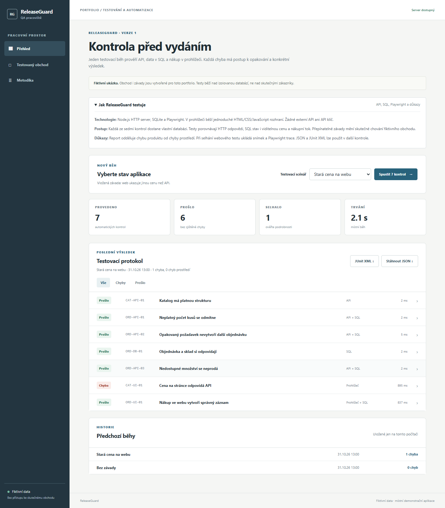

# ReleaseGuard

**Ukázkové QA pracoviště, které skutečně testuje fiktivní e-shop.** Jedním kliknutím spustí sedm kontrol API, SQLite databáze a nákupu v prohlížeči. Výsledek uchová očekávání, skutečný stav, kroky k opakování a u chyby webu také screenshot a Playwright trace. Přepínatelné závady ukazují, že testy chyby opravdu zachytí.



## Co aplikace umí

- **Zdravý scénář:** všech sedm kontrol projde.
- **Čtyři vložené závady:** duplicitní objednávka při opakovaném požadavku, neodečtený sklad, přijetí nulového množství a rozdílná cena na webu a v API.
- **Izolace testů:** každá kontrola dostane vlastní SQLite databázi se stejnými fiktivními produkty. Jedna chyba proto nemění vstup další kontroly.
- **Skutečné ověření:** testy volají místní HTTP API, čtou SQL tabulky a procházejí nákup přes Playwright. Snímky a trace vznikají jen při selhání prohlížečového testu.
- **Přehled výsledků:** filtr chyb, detail nálezu, historie běhů, JSON protokol, JUnit XML pro CI a samostatné hlášení chyby ve formátu Markdown.
- **Technické vysvětlení:** rozklikávací panel ukazuje použité technologie, izolaci testů a vznik důkazů.
- **Malý testovaný obchod:** tři fiktivní produkty a místní nákupní formulář, který lze otevřít a vyzkoušet ručně.

## Spuštění

Vyžaduje **Node.js 24+**. Doporučený postup:

```bash
pnpm install
pnpm exec playwright install chromium
pnpm start
```

Otevřete [http://127.0.0.1:4191](http://127.0.0.1:4191). Na Windows aplikace při chybějícím Chromium zkusí místně nainstalovaný Microsoft Edge. Cestu k prohlížeči lze nastavit proměnnou `RELEASEGUARD_BROWSER_PATH`. Jádro aplikace nepoužívá placené API ani API klíč.

```bash
pnpm test
pnpm qa
```

`pnpm test` ověřuje pravidla obchodu, JUnit export a bezpečnostní chování místního serveru. `pnpm qa` spustí prohlížečovou regresi v izolované dočasné databázi: zdravý běh, závadu ceny, screenshot, stažení JUnit XML i hlášení, historii, mobilní rozložení a ruční nákup. Vytvoří `docs/preview.png` a `docs/mobile-preview.png`.

## Stav ověření

| Scénář | Prošlo | Nalezené chyby | Chyba prostředí |
|---|---:|---:|---:|
| Bez závady | 7/7 | 0 | 0 |
| Opakovaná objednávka | 6/7 | 1 | 0 |
| Nesoulad skladu | 5/7 | 2 | 0 |
| Chybějící validace | 6/7 | 1 | 0 |
| Stará cena na webu | 6/7 | 1 | 0 |

Výsledky pocházejí ze skutečných místních běhů, nikoli z připravených barevných karet. Podrobnosti a hranice ověření jsou v [docs/QA.md](docs/QA.md).

## Architektura a hranice

`store.mjs` obsahuje fiktivní produkty, objednávky a čtyři testovací závady. `server.mjs` poskytuje pouze vlastní statické stránky a místní API. `runner.mjs` spouští sedm kontrol nad izolovanými databázemi a ukládá výsledky do ignorovaného `data/`; důkazy selhání do ignorovaného `artifacts/`. Rozhraní je v `web/`.

Server naslouchá jen na `127.0.0.1`, kontroluje `Host` a `Origin`, omezuje velikost JSON a nepřijímá libovolné URL ani cizí soubory k testování. **Není určen k veřejnému nasazení ani ke skutečným zákaznickým datům.** Nemá účty, správu práv ani produkční ochranu proti opakovanému spouštění. Chyba prohlížečového prostředí se ve výsledku označí samostatně, aby nevypadala jako chyba produktu. Úspěch sedmi kontrol neprokazuje úplnou bezchybnost obchodu.

## English summary

ReleaseGuard is a local QA portfolio project that tests a fictional shop rather than displaying prewritten results. Seven checks cover HTTP API contracts, input validation, idempotent order creation, SQLite inventory consistency, stock limits, visible prices, and a browser checkout. Four injected faults demonstrate that the suite detects real differences. Failed browser checks retain a screenshot and Playwright trace; findings include expected and observed results, reproduction steps, JSON and JUnit XML exports, and a Markdown bug report. An expandable note explains the test architecture. Tests use isolated SQLite databases, so runs are repeatable. Node.js 24+, Playwright, and a local browser are required. The server is loopback-only and must not be exposed as a production service.
